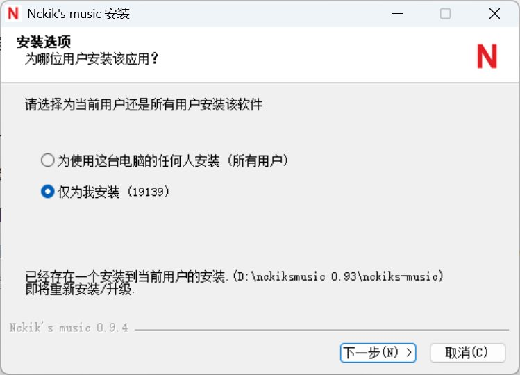

# Nckik′s music 工程说明（源码版 v0.9.4）

这是一个 **Electron 桌面音乐播放器**：左侧封面 + 右侧逐字歌词 + 单个播放列表，支持本地文件与网易云音乐 / QQ 音乐 / 哔哩哔哩 / 酷狗（登录入口暂时下线）四个在线来源。

本说明面向「把这套源码拿到另一台电脑上继续开发」的场景，按顺序照做即可跑起来；**只想装来听歌**的读者可以直接跳到文末的[用户使用说明附录](#附录用户使用说明v094)。

---

## 1. 环境要求

| 依赖 | 版本要求 | 说明 |
| --- | --- | --- |
| Windows | 10 / 11 x64 | 本项目只在 Windows 上验证过 |
| Node.js | **20 LTS 或更高**（开发机为 24.11） | 内置 npm，用来装依赖、编译、打包 |
| Python | 3.8+（开发机 3.12） | **只有重新生成图标时才需要**（`player/tools/make-ico.py`） |
| PowerShell | 5.1+ | 仓库自带的启动/打包脚本是 `.ps1` |
| Git | 任意 | 可选，但强烈建议（下文有克隆方式） |

不需要全局安装 Electron：依赖装在工程里，用 `npx` 或 `node_modules\electron\dist\electron.exe` 调用。

---

## 2. 三分钟跑起来

```powershell
# 1) 进入工程目录（这里解压出来的目录名以实际为准）
cd NckiksMusic-src-0.9.4\player

# 2) 安装依赖（约 390 MB，首次 2–5 分钟）
npm ci

# 3) 编译账号模块（TypeScript；产物在 accounts\dist，已随包附带一份，改代码后必须重编）
npx tsc -p tsconfig.accounts.json

# 4) 启动
npx electron .
```

> 也可以回到解压目录，右键 `启动开发版.ps1` →「使用 PowerShell 运行」，它会带好环境变量直接启动（见第 6 节的两个坑）。

启动后应该看到一个无边框窗口：左侧封面、右侧歌词、底部进度条与控制按钮。

---

## 3. 在本机验证「原有功能没被改坏」

仓库自带一批 Electron 探针（`player/demo/probe-*.js`），它们会启动真实主进程、点真实按钮、断言 DOM 与主进程返回。

```powershell
cd NckiksMusic-src-0.9.4\player

# 逐个跑（每个 5–20 秒）
npx electron --no-sandbox demo\probe-home.js
npx electron --no-sandbox demo\probe-playlist.js
npx electron --no-sandbox demo\probe-playmode.js
npx electron --no-sandbox demo\probe-brand.js
npx electron --no-sandbox demo\probe-edge.js
npx electron --no-sandbox demo\probe-quality-ui.js
npx electron --no-sandbox demo\probe-bil.js        # 哔哩哔哩，需要登录态，否则部分断言跳过

# 账号层单元测试（纯 Node，不需要 Electron）
node tools\test-accounts.mjs
```

v0.9.4 的基线：`playmode 48/48`、`brand 15/15`、`edge 19/19`、`quality-ui 39/39`、`playlist 53/53`、`home 50/50`、`test-accounts 76/76`。探针会把截图写到 `player\screenshots\`（目录不存在时会自己创建），失败项的详情打印在控制台。
跑之前请先确认没有残留的 electron 进程，否则会出现「窗口数不对」的假失败；也不要连着秒跑两个探针（音频设备与单实例锁会互相干扰，表现为偶发的 50/53 假失败），中间隔 2–3 秒。

`启动开发版.ps1 -Probe all` 可以一次跑完整批（脚本里维护着探针清单），加上 `-ExecutionPolicy Bypass` 才能在受限环境下执行。

---

## 4. 目录结构

```
NckiksMusic-src-0.9.4\
├─ player\                      ← 应用本体（所有运行时代码都在这里）
│  ├─ main.js                  主进程：窗口、协议注册、IPC、缓存、单实例
│  ├─ preload.js               contextBridge，把 window.api 暴露给渲染层
│  ├─ netease.js               网易云：登录、搜索、歌单、歌词、取流
│  ├─ bilibili.js              哔哩哔哩：WBI 签名、搜索、收藏夹、取流
│  ├─ bilibili-qr.js           哔哩哔哩扫码（官方登录页 + 隐藏窗口读 cookie）
│  ├─ upstream-library.js      QQ 音乐 / 酷狗：歌单、曲目、搜索、推荐
│  ├─ upstream-meta.js          上游曲目的封面 / 歌词 / 翻译
│  ├─ stream-resolve.js        上游取流：vkey、酷狗签名、合规上游网关
│  ├─ renderer\                渲染层（无框架，原生 JS）
│  │  ├─ index.html
│  │  ├─ app.css               全部样式（含主题变量、歌词排版）
│  │  ├─ app.js                主界面逻辑：播放、队列、曲库、歌词、设置
│  │  └─ accpanel.js           设置页「播放账号」两张卡（QQ 音乐 App / 酷狗）
│  ├─ accounts\                账号抽象层（TypeScript 源码 + 编译产物）
│  │  ├─ src\                  types / errors / credentialStore / loginSession /
│  │  │                        stream / accountManager / providers{qq,kugou,qqapp} /
│  │  │                        mqtt / wsConnect / ipcContract / electronHost / index
│  │  ├─ renderer\accountPanel.ts
│  │  └─ dist\                 tsc 编译产物（运行时 require 这里）
│  ├─ assets\                  字体、图标等静态资源（11 MB，必须保留）
│  ├─ build\                   打包用图标：icon.ico（16/32/48/256）、icon.png（512）
│  ├─ tools\make-ico.py        重新生成图标
│  ├─ tools\test-accounts.mjs  账号层单测
│  ├─ ENV.example              环境变量参考（开发者开关，不读 .env）
│  ├─ demo\                    探针脚本（probe-*.js）与一次性诊断脚本
│  ├─ package.json             脚本、electron-builder 配置、依赖
│  └─ tsconfig.accounts.json   accounts 模块的编译配置
├─ tools\                      早期一次性探测脚本（QQ/酷狗接口调研）
├─ 启动开发版.ps1              开发启动器（含探针参数）
├─ 启动播放器.bat              旧启动器（保留）
├─ 开发说明.md                 最早一版开发环境说明（历史记录）
├─ 音乐播放器设计方案.md        主线设计文档 + 各版本变更记录（§14 起）
├─ player\QQ与酷狗扫码登录-实现方案.md   账号 / 扫码 / 取流 / 上游网关的实现细节
├─ NckiksMusic-用户说明-v0.9.4.docx     面向最终用户的说明书
└─ music-player-prototype.html          最早的静态原型（参考用，不参与构建）
```

**没有打进包里的东西**（都在 `.gitignore` 里，需要时重新生成）：

| 目录/文件 | 为什么不打 | 怎么恢复 |
| --- | --- | --- |
| `player\node_modules\` | 390 MB，`npm ci` 可复现 | `cd player; npm ci` |
| `player\dist\` | 625 MB，安装包产物 | `npx electron-builder --win --x64` |
| `player\screenshots\` | 11 MB，探针跑的截图 | 跑探针会重新生成 |
| `player\demo\shot-*.png` | 探针截图 | 跑探针会重新生成 |
| — | 演示素材 `demo\demo.wav`、`demo.png`、`demo.lrc` **已随包附带**（探针依赖它们） | 需要重建时 `node demo\make-demo.js` |
| `.tmp\` | 本机临时诊断产物 | 无需恢复 |

---

## 5. 改代码时最常碰到的地方

| 想改的东西 | 位置 |
| --- | --- |
| 窗口尺寸 / 无边框 / 标题栏按钮 | `player/main.js` 的 `createWindow()`，样式在 `renderer/app.css` 的 `.titlebar` |
| 歌词排版（字号、行距、逐字进度、间奏「…」） | `renderer/app.css` 的 `.lyr / .ln / .ch / .gap-*`；逻辑在 `app.js` 的 `renderLyric / updateLyric` |
| 播放队列、切歌、随机 / 单曲 / 顺序 | `renderer/app.js` 的 `S.q / playAt / stepIndex / shufNext` |
| 播放列表面板（左下按钮打开的那个） | `app.js` 的 `renderPl / plSources / plSelectSource`，样式 `.pop-pl` |
| 曲库抽屉（本地 / 网易云 / 哔哩哔哩 / QQ / 酷狗） | `app.js` 的 `setSource / renderLibrary / renderNet / renderBil / renderUp` |
| 设置页 | `renderer/index.html` 的 `#dSet` + `app.js` 的 `openDrawer / paintSettings` |
| 账号卡片（QQ 音乐 App 扫码、酷狗敬请期待） | `renderer/accpanel.js` + `accounts/src/providers/*` |
| QQ 音乐 / 酷狗接口 | `player/upstream-library.js`、`upstream-meta.js`、`stream-resolve.js` |
| 新增一个在线音源 | 参照 `bilibili.js`：实现 `status/search/playlist/track/lyric`，在 `main.js` 注册 IPC 与自定义协议，再到 `app.js` 的 `setSource` 加一段 |

约定：IPC 通道名统一 `<平台>:<动作>`（`ne:` / `bil:` / `kg:` / `acc:` / `idn:`），返回 `{ ok: true, ... }` 或 `{ ok: false, error: { code, message } }`。渲染层只通过 `window.api.*` 调主进程，不直接 `require`。

---

## 6. 两个必踩的环境坑（Windows 特有）

1. **`ELECTRON_RUN_AS_NODE=1`**
   如果当前 shell 里有这个环境变量，Electron 会退化成纯 Node，启动时会报 `bad option: --no-sandbox` 然后直接退出、不出窗口。
   → 启动前执行：`Remove-Item Env:ELECTRON_RUN_AS_NODE -ErrorAction SilentlyContinue`

2. **受限令牌下 Chromium 沙箱起不来**
   某些账户策略下裸启动会崩在 `IsSandboxedProcess`（`EXCEPTION_BREAKPOINT`）。
   → 开发与探针一律加 `--no-sandbox`（`启动开发版.ps1` 已内置）。

另外：如果 `%TEMP%` 不可写，把 `TMP` / `TEMP` 指到工程内的 `.tmp` 目录再启动，否则 Chromium 会启动失败。

---

## 7. 构建与打包

```powershell
cd NckiksMusic-src-0.9.4\player

# 重新生成图标（白底正红 N，输出 16/32/48/256 的 .ico 与 512 的 .png）
python tools\make-ico.py

# 出安装包 + 免安装版（产物在 player\dist）
$env:CSC_IDENTITY_AUTO_DISCOVERY = 'false'    # 没有签名证书时必须关掉自动查找
npx electron-builder --win --x64
```

产物：

- `dist\NckiksMusic-Setup-<version>.exe` —— NSIS 安装包（默认装到 `%LOCALAPPDATA%\Programs\nckiks-music`，创建桌面与开始菜单快捷方式）
- `dist\NckiksMusic-Portable-<version>.exe` —— 免安装单文件
- `dist\win-unpacked\` —— 解包目录，排查打包问题最快

> **产品名只能用 ASCII 撇号**：`package.json` 的 `productName` 曾是 `Nckik′s music`（U+2032），NSIS 写 `Uninstall <name>.exe` 时会失败，安装到一半报「无法关闭」/「不能打开要写入的文件」。v0.9.4 起改为 `Nckik's music`，界面标题仍显示 ′ 品牌写法。改版本号时同时改 `version`，探针 `probe-brand` 会按它去找安装包。

---

## 8. 运行时数据在哪

| 路径 | 内容 |
| --- | --- |
| `%APPDATA%\NckiksMusic\settings.json` | 主题、音量、播放列表、上游网关配置 |
| `%APPDATA%\NckiksMusic\library.json` | 本地曲库索引 |
| `%APPDATA%\NckiksMusic\accounts.bin` | 账号列表（safeStorage 加密后的凭据） |
| `%APPDATA%\NckiksMusic\identity.json` | 当前选中的音源账号 |
| `%APPDATA%\NckiksMusic\crash.log`、`*.log` | 崩溃与功能日志 |
| `%APPDATA%\NckiksMusic\Partitions\<name>\` | 各平台登录用的独立会话（cookie 在这里） |

调试时可以直接删掉整个 `NckiksMusic` 目录回到「全新安装」状态；注意这会丢掉登录态与播放列表。

---

## 9. 在线音源的前提

| 来源 | 登录方式 | 取流 |
| --- | --- | --- |
| 网易云音乐 | 扫码（官方网页登录页） | 官方接口，部分曲目受版权/会员限制 |
| QQ 音乐 | **手机 QQ 音乐 App 扫一扫**（`CreateQRCode` + MQTT 推送 + `Login` 换 musickey） | 自己实现 vkey 取流，非会员曲可播 |
| 哔哩哔哩 | 手机 B 站扫码（官方登录页） | `playurl` 的 dash 音频轨 |
| 酷狗音乐 | 登录入口暂时下线（「敬请期待」） | 免费曲仍可播 |

**VIP 曲目**：酷狗与 QQ 音乐的会员曲目需要平台侧权益，本项目不绕签名，也不伪造行为指纹。酷狗若要播会员曲，走「合规上游网关」：在设置 → 播放账号 → 酷狗卡片里填网关地址（例如自建的 `KuGouMusicApi`），主进程会先问网关、失败再退回免费链路。

---

## 10. 常见问题

**Q：`npm ci` 很慢或失败？**
换国内镜像：`npm config set registry https://registry.npmmirror.com`，再重试。Electron 二进制下载慢时可以设 `ELECTRON_MIRROR=https://npmmirror.com/mirrors/electron/`。

**Q：启动后窗口一片空白？**
打开开发者工具（`Ctrl+Shift+I`）看渲染层报错；常见原因是 `accounts\dist` 没编译（主进程会打印 `[acc] 账号模块未启用`）。跑一次 `npx tsc -p tsconfig.accounts.json`。

**Q：改了 `accounts\src` 的 TS，为什么不生效？**
运行时加载的是 `accounts\dist`。每次改完都要 `npx tsc -p tsconfig.accounts.json` 重新编译。

**Q：探针报「窗口数不对」/ 一直卡住？**
先 `Get-Process electron | Stop-Process -Force` 清干净，再单独跑一个探针；探针之间会互相干扰。

**Q：双击 `启动开发版.ps1` 报 AuthorizationManager check failed？**
用 `powershell -ExecutionPolicy Bypass -File .\启动开发版.ps1`。

**Q：想从 git 历史恢复某个版本？**
工程根目录带完整 `.git`，`git log --oneline` 能看到从 0.4.1 到 0.9.4 的每一步（提交信息里有原因与验证）。回滚某个文件：`git checkout <commit> -- player/main.js`。

---

## 11. 版本与文档索引

| 文档 | 内容 |
| --- | --- |
| `音乐播放器设计方案.md` | 主线设计文档，§14 起是逐版本的「现象 / 根因 / 改动 / 验证 / 提交号」记录，改功能前先在这里补一节 |
| `player\QQ与酷狗扫码登录-实现方案.md` | 账号抽象、扫码协议、取流、上游网关的完整说明（§1–§32） |
| `player\README.md` | 应用自身的说明（偏历史，早期版本） |
| `开发说明.md` | 最初的开发环境与排障记录 |
| `NckiksMusic-用户说明-v0.9.4.docx` | 面向最终用户的操作说明（同一份内容也贴在本文末尾的[附录](#附录用户使用说明v094)） |
| `docs/manual/` | 上表 docx 里的插图（从 docx 导出、压到 1280px 宽），README 附录直接引用 |

当前版本 **0.9.4**（`player\package.json` 的 `version`，界面设置页显示同一个值）。

---

## 附录：用户使用说明（v0.9.4）

> 与仓库里的 [NckiksMusic-用户说明-v0.9.4.docx](NckiksMusic-用户说明-v0.9.4.docx) 同源；图片已导出到 [docs/manual/](docs/manual/)，可在网页上直接看。

版本 0.9.4 | Windows 10 / 11（64 位） | 本地音乐播放器 + 在线音源
适用对象：在自己电脑上听本地音乐、同时会用网易云音乐 / QQ 音乐 / 哔哩哔哩账号的普通用户。

### 1 软件简介与适用场景

#### 1.1 这是什么

Nckik′s music 是一个 Windows 桌面音乐播放器。它一边播放你电脑里的音乐文件，一边可以登录常用的音乐平台账号，把歌单、收藏夹和在线曲目放到同一个播放列表里播放。
- 本地播放：直接把 MP3 / FLAC / WAV / M4A / OGG 拖进窗口即可播放，自动读取内嵌封面与歌词，同目录的 .lrc 也会自动加载。
- 在线音源：网易云音乐、QQ 音乐、酷狗音乐、哔哩哔哩四个来源，可以在曲库里切换查看。
- 歌词体验：逐字滚动、长句分段、间奏显示「…」并缓慢呼吸，支持和声/翻译双语显示。
- 播放列表：整个软件只有一个播放列表，所有来源的歌都汇总到这里，按你的顺序播、随机播或单曲循环。

#### 1.2 适合谁用

- 电脑里有大量本地音乐，想要一个不花哨、启动快、歌词好看的播放器。
- 平时用网易云 / QQ 音乐 / 哔哩哔哩听歌，希望把几个平台的歌单放到一个列表里连着放。
- 想把桌面播放器当成日常背景音乐，用快捷键切歌、看歌词。

不适合的场景：需要下载音乐文件、需要多设备同步、需要在线听会员曲库以外的付费内容。


### 2 安装与卸载

#### 2.1 用安装包安装（推荐）

1. 双击 NckiksMusic-Setup-0.9.4.exe。右键管理员运行
1. 如果 Windows 弹出「SmartScreen 已保护你的电脑」，点「更多信息」→「仍要运行」。（安装包未做代码签名，属正常提示。）
1. 按向导默认选项一路「下一步」，选择安装位置后点「安装」。
1. 安装完成后，桌面和开始菜单会出现「Nckik′s music」图标；勾选「运行」即可直接打开。

说明：默认安装到当前用户目录，不需要管理员权限，也不会修改系统设置。

#### 2.2 免安装版

1. 把 NckiksMusic-Portable-0.9.4.exe 放到任意文件夹（建议单独建一个目录，例如 D:\Tools\NckiksMusic）。
1. 双击运行，无需安装；首次启动会在同目录创建临时文件。
1. 想卸载时直接删除该 exe 即可。

#### 2.3 卸载

1. 打开「设置 → 应用 → 已安装的应用」，找到 Nckik′s music，点「卸载」。
1. 或者从开始菜单「Nckik′s music」文件夹里运行「Uninstall Nckik′s music」。
1. 按提示确认卸载。卸载只删除程序文件。

如果希望连账号登录状态、播放列表一起清干净：卸载后手动删除 %APPDATA%\NckiksMusic 目录（在资源管理器地址栏粘贴该路径即可）。


*图 2 安装向导与桌面快捷方式*

### 3 界面与主要功能

#### 3.1 主界面

- 左侧大图：当前歌曲封面；没有封面时显示首字母占位。
- 右侧歌词：当前句高亮、逐字推进，上下是前后句。
- 底部：进度条 + 中间控制按钮（随机 / 上一首 / 播放暂停 / 下一首 / 循环模式）+ 右侧音量与播放列表按钮。
- 右上角：齿轮是设置，最左边的小人图标是「当前账号」。


#### 3.2 窗口内快捷键

- 空格：播放 / 暂停；← →：快退 / 快进 5 秒
- L：显示 / 隐藏歌词；双击标题栏：最大化 / 还原
- Ctrl + O：导入本地文件；把文件拖进窗口同样可以
- Ctrl + Alt + P：全局播放 / 暂停（其他窗口聚焦时也生效）
- Ctrl + Alt + ← →：全局上一首 / 下一首；Ctrl + Alt + ↑ ↓：全局音量微调

全局快捷键可在「设置 → 快捷键」里开关；若提示「键位冲突」，说明被其他程序占用。

#### 3.3 播放列表

点底部右侧的列表按钮（带数字角标）打开。所有来源的歌曲都汇总在这里，列表本身可以无限长。
- 点条目即播放；↑ ↓ 调整顺序；× 只从列表移除，不影响来源歌单。
- 「选择歌单」：从当前账号的歌单里整单替换进来。
- 「插入歌曲」：从曲库挑单曲追加到列表末尾，重复的会自动跳过。
- 底部中间的按钮切换播放模式：顺序 → 单曲循环 → 随机。


#### 3.4 曲库与账号

点右上角「当前账号」的头像，右键会展开账号面板，可以在网易云音乐、QQ 音乐、哔哩哔哩之间切换；切换后，曲库和「选择歌单」只显示这个账号的内容。
- 本地：导入文件 / 文件夹，支持在已导入的曲库里搜索。
- 网易云音乐：扫码登录后可看每日推荐、推荐歌单、我创建的歌单。
- QQ 音乐：用手机 QQ 音乐 App 的「扫一扫」扫描窗口里的二维码登录（官方登录通道）。
- 哔哩哔哩：扫码登录后可读收藏夹，搜索按视频粒度返回。
- 酷狗音乐：登录功能显示「敬请期待」，曲库中的免费曲目仍可试听。


#### 3.5 设置

- 外观：夜间 / 日间 / 自动（按经纬度算日出日落）。
- 封面取色：播放时整窗背景跟随封面主色。
- 歌词翻译：外文歌有译文时在原文下方显示中文。
- 音频输出：选择输出设备。
- 播放账号：查看登录状态、切换账号、退出登录。

### 4 常见问题与排查

#### 4.1 双击没反应 / 一闪而过

1. 先看窗口是否被最小化到后台，任务栏里是否有图标。
1. 如果确实没有任何窗口：打开 %APPDATA%\NckiksMusic\crash.log，把最后几十行发给开发者。
1. 用免安装版复测一次，排除安装目录权限问题。

#### 4.2 没有声音

1. 确认底部进度条在走、按钮显示为「暂停」图标。
1. 点右下角喇叭图标，检查是否静音或音量过低。
1. 「设置 → 音频输出」里换一个输出设备（插拔耳机后尤其常见）。

#### 4.3 封面 / 歌词不显示

- 本地文件：确认歌曲文件里确实带封面；或把同名 cover.jpg / 同名 .lrc 放在歌曲旁边。
- 在线曲目：部分歌曲上游本身不提供封面或歌词，界面会显示「暂无封面」「这首歌上游没有提供歌词」。
- 网络不稳时封面可能延迟出现，切下一首再切回来即可重试。

#### 4.4 QQ 音乐登录

1. 点「QQ 音乐」卡片上的「扫码登录」，窗口里会出现二维码。
1. 用手机 QQ 音乐 App →「我的」→ 右上角「扫一扫」，扫描后在手机上确认。
1. 确认成功后，卡片会显示昵称；若一直停在「请扫码」，点「重新获取」换一张二维码再扫。

#### 4.5 提示「键位冲突」

说明该全局快捷键已被其他程序占用（常见于输入法、录屏软件）。到「设置 → 快捷键」关掉全局快捷键，或在与冲突软件之间二选一。

#### 4.6 安装时提示「无法关闭」或「不能打开要写入的文件」

这是 0.9.3 及更早版本的安装包在中文系统上的问题（产品名里用了特殊字符，安装程序写卸载文件时失败），0.9.4 起已修复。处理办法：

1. 点「中止(A)」退出当前安装，不要点「忽略」，否则会缺卸载文件。
1. 改用本说明对应的 0.9.4 安装包（NckiksMusic-Setup-0.9.4.exe）。
1. 如果之前装到一半留下了空目录，可以手动删除后再装。

#### 4.7 歌曲点了没反应

- 该曲目可能已失效（在线曲目链接过期、本地文件被移动或删除）。
- 程序会自动跳到下一首可播放的曲目；如果整张列表都失效，请更换歌单或重新导入文件。
- 如果是酷狗音乐的会员曲目，界面会提示需要会员权益。


### 5 版本信息与反馈渠道

#### 5.1 当前版本

- 软件版本：0.9.4
- 发布形式：安装包（NckiksMusic-Setup-0.9.4.exe）+ 免安装版（NckiksMusic-Portable-0.9.4.exe）
- 支持系统：Windows 10 / 11，64 位
- 数据目录：%APPDATA%\NckiksMusic（设置、曲库、登录凭据、日志）

升级方式：直接运行新版本安装包覆盖安装，播放列表与登录状态会保留；免安装版替换 exe 即可。

#### 5.2 本版主要变化

- 新增 QQ 音乐 App 扫码登录与 QQ 音乐曲库（歌单、曲目、每日推荐、搜索、封面与歌词翻译）。
- 曲库内所有歌单二级界面统一「返回上一级」按钮。
- 酷狗音乐登录入口暂时下线，显示「敬请期待」；其曲库免费曲仍可试听。
- 应用图标统一为白底正红字母 N，安装包与窗口图标同步替换。
- 修复 0.9.3 在中文系统上安装到一半报「无法关闭」「不能打开要写入的文件」的问题（产品名改为标准 ASCII 撇号）。

#### 5.3 如何反馈

遇到问题时，请尽量提供以下信息，便于快速定位：
- 软件版本（设置页底部或「设置 → 关于」显示 v0.9.4）
- 问题现象与复现步骤（例如：点某歌单第 3 首，界面一直转圈）
- 截图或录屏
- 日志文件：%APPDATA%\NckiksMusic\crash.log（崩溃）与同目录下的 *.log（功能日志）

#### 5.4 使用须知

- 在线音源经由各平台官方网页 / 客户端登录通道获取，账号权限（如会员曲）由平台决定，本软件不提供绕过。
- 请仅用于个人学习与日常听歌，不要用于商业分发或二次销售。
- 在线曲目的可用性会随平台调整而变化，若某个来源长期失效，建议先在设置里切换账号或改用本地文件。

—— 文档结束 ——
